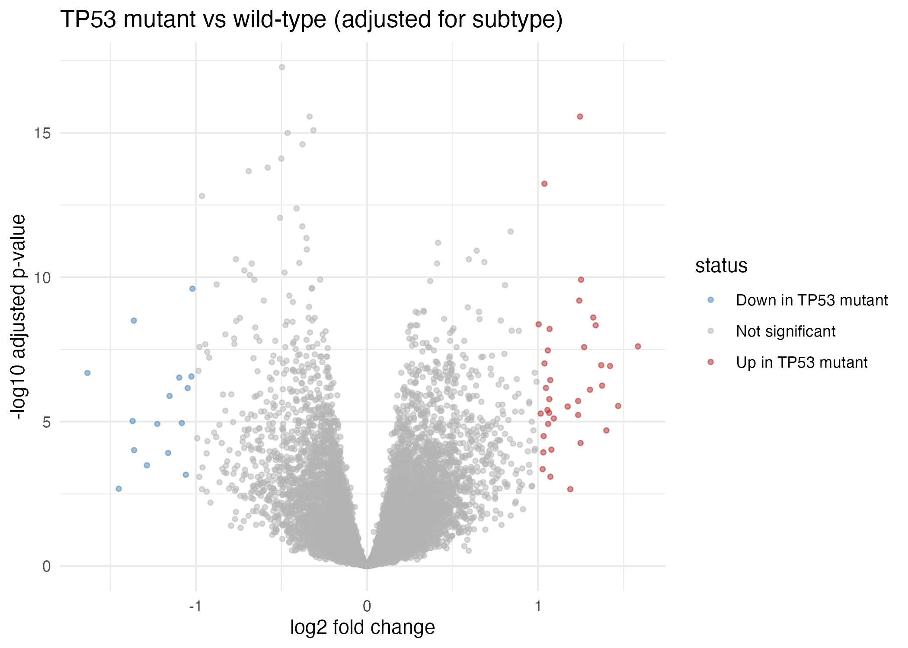
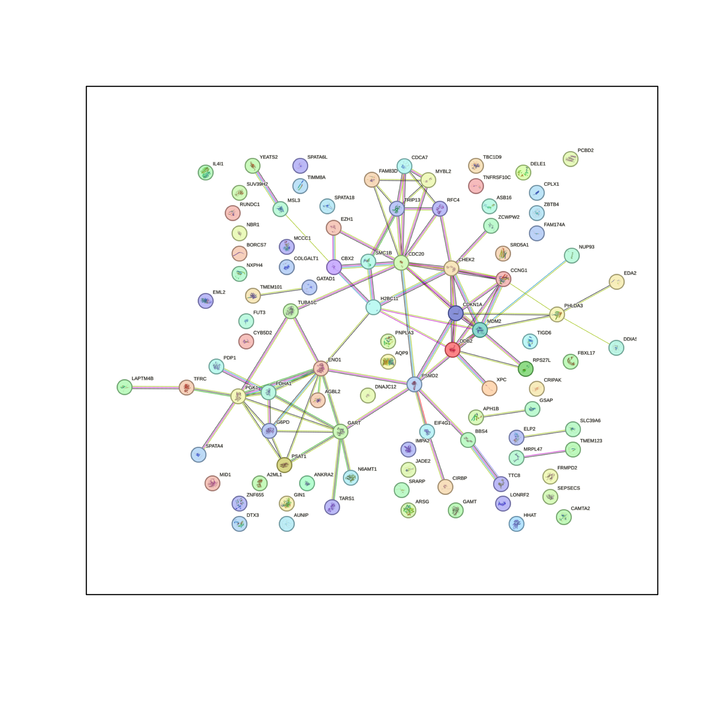
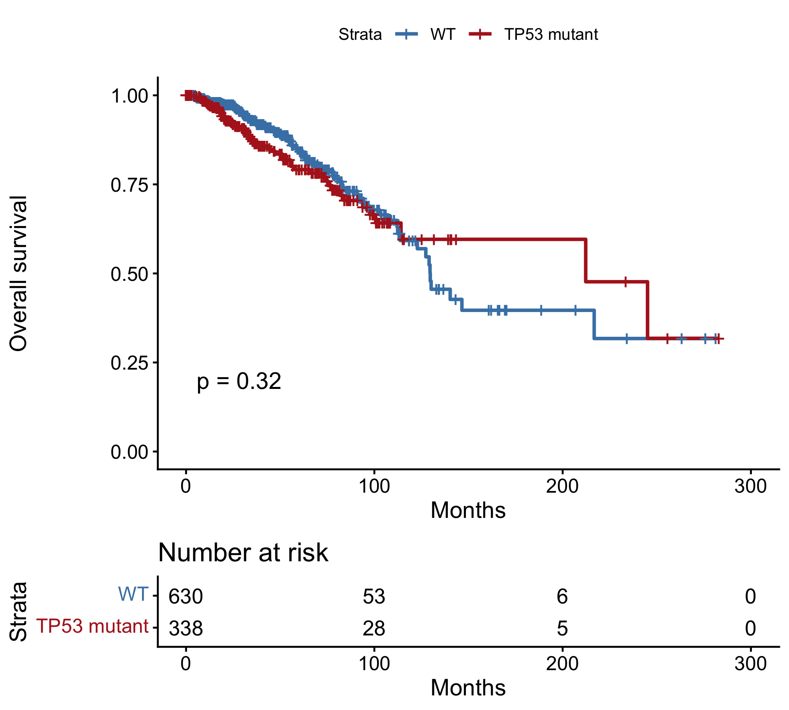

# TP53 mutation in TCGA breast cancer

## Question
How does TP53 mutation status relate to gene expression and survival in TCGA breast cancer, after accounting for PAM50 subtype?

## Data
TCGA-BRCA PanCancer Atlas (via cBioPortalData): somatic mutations, RNA-seq (RSEM), clinical data. STRING v12.0 for networks and enrichment.

## Methods
- Defined TP53-mutant tumors as those with a non-silent somatic TP53 mutation (346 mutant, 661 wild-type among 1,007 tumors with both mutation and expression data; 981 with a PAM50 subtype).
- Differential expression with limma (log2 RSEM + 1), adjusting for subtype.
- STRING network and enrichment for the top 100 genes, using all tested genes as background.
- Kaplan-Meier and Cox regression for overall survival (968 tumors, 132 deaths), adjusted for subtype.

## Results
- Top genes lower in TP53-mutant tumors are classic p53 targets (DDB2, XPC, MDM2, CDKN1A, RPS27L), as expected when p53 function is lost.
- STRING enrichment recovered literature on TP53 mutational effects on gene expression, plus checkpoint and DNA damage response terms.
- Survival: HR 1.08 (95% CI 0.67-1.73, p = 0.75) after subtype adjustment; no detectable association.

*Network of the top 100 genes ranked by adjusted p-value (97 mapped to STRING; interaction score ≥ 0.4).*

## Limitations
- TP53 status is based on somatic mutation calls only (no copy number or methylation).
- All non-silent mutations are grouped together, regardless of type.
- Only 132 deaths, so survival power is limited.
- Reproduces known biology; this is a learning project, not a novel finding.

## Reproduce
Run `analysis.R` in R. Package versions are in `results/sessionInfo.txt`.
